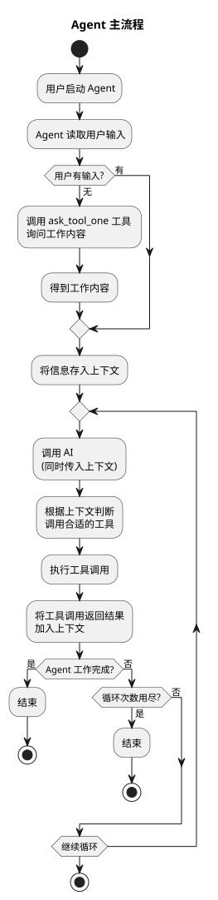
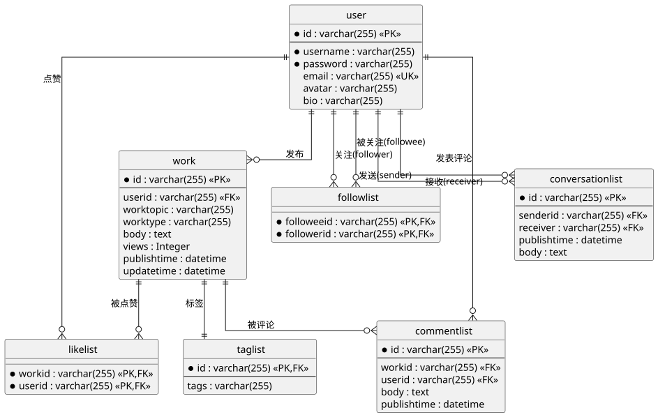

# 基于 -`Agent添加网页资源`- 的`AI及其衍生产品`讨论与资源分享论坛网站

**本网页面向 AI/Agent 及其衍生项目的了解者，针对术语翻译不专业、项目复杂度高、论述方向过宽等障碍，搭建用户与项目之间的桥梁：以简洁明了的描述提供项目介绍，用户确认项目对自己有用后，可通过帖子中的项目地址深入探究。**

**项目实现功能**：前端基于 **Vue** 框架构建，后端由 **SpringBoot** 框架构建并严格遵循 **MVC 软件架构设计模式**，另以 **Python 脚本**实现 Agent 程序：网页端实现`登录/注册`、`帖子浏览与发布`、`帖子搜索`、`筛选`、`个人主页`、`关注`、`点赞`、`评论及私聊`等论坛常见功能；Python 脚本作为填充系统资源的 Agent 程序，实现`项目资源获取`、`项目筛选`、`项目总结`、`项目发布`全流程，让网页真正做到起作用。网站虽聚焦于 AI 及其衍生产品的讨论与资源分享，但资源分享暂不提供下载功能，而是通过 URL 路由到其他网站（主要是 GitHub）进行对应下载；对于用户上传的`资源内容`，网页会通过接入的`语言模型`对其进行审查，以保证资源与网页主题相关，并在此过程中限制用户发布次数，节约 token 成本；系统提供的`发帖功能`支持简易的`markdown`标记，使帖子更加生动形象；系统还会提供`线上非即时聊天`功能，让用户之间能够进行交流讨论。

## 关键或亮点功能的实现

### 目录

- 1. python语言Agent的实现
- 2. 后端AI审查的实现
- 3. 多次发帖限制的实现
- 4. 后端token解析后userid保留的实现
- 5. 前端特效页面的实现

#### 1.python语言Agent的实现

该Agent最主要实现是 `OpenAI 的函数调用`，通过将自己定义的python函数封装成专门给AI使用的工具，实现agent
- 以下是一个基本的工具定义例子，为AI解释清楚工具的使用
```python
class ask_tool_one_params(BaseModel):
    """这个为你和用户之间提供交互工具，你发送信息给用户，用户返回信息给你
    当你对某一步骤有疑问时，可以调用，具体如下：
    你不知道用户想要的输出时；你发现你解决不了的问题时；还有其他，只要你觉得有疑问的地方，都应该调用这个工具
    """
    ask: str = Field(description= "你输入给用户的内容")
```
- 之后再将工具类与具体的函数关联，就成为了AI的工具
```python
TOOLS = [
    pydantic_function_tool(ask_tool_one_params, name="ask_tool_one"),
    .......  #其他工具
]

TOOL_REGISTRY = {
    "ask_tool_one": AskToolOne.ask_tool_one,
    .......  #其他工具
}
```
- 本agent中总共定义了10个工具，它们分别完成以下任务
```text
ask_tool_one            agent遇到问题时与用户的询问交互工具
reset_tool_one          重置记录中被筛选但是没被使用的记录
get_message_tool_one    agent获得记录统计数据的工具
search_tool_one         拉取github中指定主题仓库的工具
select_tool_one         筛选符合要求的记录
search_tool_two         获取项目的readme介绍
de_markdown_tool_one    将readme拆解，缩减，以免传入过大文本量
summarize_tool_one      将拆解的文本总结成CY网页合适的帖子格式
send_tool_one           以CY网页用户的身份发送帖子
send_tool_two           获取token
```

- 在这个过程中，为了防止出现项目简介过大的情况，引用了github上的长段落提取出短句项目`testteaser`

- agent工作流程



#### 2.后端AI审查的实现

- 为了实现后端AI审核，必须要在请求到达Controller之前，将请求截取

```java
public CachedBodyRequestWrapper(HttpServletRequest request) throws IOException {
        super(request);
        // 一次性把原始流读完，缓存到内存
        this.cachedBody = request.getInputStream().readAllBytes();
    }
```

- 并且由于在spring框架中，请求有流的性质，被拦截之后就会消失，所以我们还需要将请求重新构造请求流

```java
public ServletInputStream getInputStream() {
    ByteArrayInputStream bais = new ByteArrayInputStream(cachedBody);
    return new ServletInputStream() {
        //构造请求
    };
}
```

- 而在两者之间，我们就会进行AI审查工作

```java
//ai审查开始，aiReview就是我们定义的AI审查工具
if("work".equals(category)){
    String result = aiReview.askForWork(userInput);
}
else if("ask".equals(category)){
    String result = aiReview.askForWork(userInput);
}
```

- 以下就是AI审查的主体部分

```java
public String askForWork(String text) {
    String TIP = """
                AI提示词
            """;
    return chatClient.prompt()
            .system(TIP)
            .user(text)
            .call()
            .content();          // 直接返回纯文本
}
```

#### 3.多次发帖限制的实现

- 多次发帖限制的实现主要是通过redis非关系数据库实现的，在每次用户发帖之后，redis中相关的记录就增加，到阈值之后，就直接抛出异常，直到第二天重置

```java
String today = LocalDate.now(ZoneId.of("Asia/Shanghai")).toString();
// 设置记录
String limitKeyPost = "post:limit:" + userid + ":" + today;
// 到当天结束的剩余秒数
long secondsUntilEndOfDay = Duration.between(
        LocalDateTime.now(),
        LocalDate.now().plusDays(1).atStartOfDay()
).getSeconds();
// 发帖后
Long postCount = postRedisTemplate.opsForValue().increment(limitKeyPost);
// 之后如果还postCount超过阈值，就会抛出异常
```

#### 4.后端token解析后userid保留的实现

- 首先，定义一个专门用来存用户id的类，乱码存放线程变量

```java
public final class UserContext {
    private static final ThreadLocal<String> USER_ID = new ThreadLocal<>();
    // 声明一个线程本地变量，为每个线程单独保存userid，线程之间互不干扰。
}
```

- 之后，我们只需要在Jwt拦截时请求时，解析出userid，并将其存储在USER_ID里面，整个线程就可以使用它，其线程之间互不干扰


#### 5.前端特效页面的实现

- 前端的动态特效组件都是来自一个组件网站，vue-bits.dev


- 在项目文件内打开智能体，并且粘贴网站提供的提示词，就可以完成组件的开发

## 各板块概括

### 一.前端

#### 前端主要Vue组件（网页或组件）

1. `HomeView.vue`网站的主页面，包含路由到登录页面等基础功能

2. `AuthView.vue`网页的登录注册页面，登录与注册两页面可以相互路由并实现登录注册|

3. `ProfileView.vue`用户的主页，展示用户的相关信息，用户与其他用户的关系，用户的相关浏览信息，以及跳转到其他页面等功能

4. `ForumView.vue`用于展示论坛的相关帖子，并且提供搜索功能，以及用户互动等功能

5. `FollowListView.vue`用于展示关注信息的组件

6. `ChatView.vue`用于用户间私聊的页面

7. `CreatePostView.vue`用于用户发布帖子的网页

8. `TalksView.vue`用于展示私聊列表的组件

9. `UserProfileView.vue`用于展示访问其他用户的页面

10. `PostDetailView.vue`用于展示帖子详情的页面

### 二.接口

#### 接口清单

| 功能             | 方法与路径                                | 认证 | 用途                                   |
| ---------------- | ----------------------------------------- | ---: | -------------------------------------- |
| 注册             | `POST /begain/register`                   |   否 | 创建账号并返回 token、用户资料         |
| 登录             | `POST /begain/login`                      |   否 | 使用邮箱登录                           |
| 当前用户资料     | `GET /users/me`                           |   是 | 初始化个人主页及账号设置               |
| 更新当前用户资料 | `PATCH /users/me`                         |   是 | 暂未实现，返回 `501`                   |
| 用户主页         | `GET /users/{userid}`                     |   是 | 获取用户资料、统计及当前用户的关注状态 |
| 用户帖子         | `GET /users/{userid}/posts`               |   是 | 获取该用户的帖子                       |
| 我的点赞         | `GET /users/me/likes`                     |   是 | 获取当前用户点赞的帖子                 |
| 帖子列表         | `GET /posts`                              |   是 | 社区帖子列表（暂不支持搜索/排序/分页） |
| 帖子详情         | `GET /posts/{postId}`                     |   是 | 获取帖子、作者、点赞状态及详情         |
| 创建帖子         | `POST /posts`                             |   是 | 发布作品帖或询问帖                     |
| 点赞             | `PUT /posts/{postId}/like`                |   是 | 点赞（幂等）                           |
| 取消点赞         | `DELETE /posts/{postId}/like`             |   是 | 取消点赞（幂等）                       |
| 帖子评论列表     | `GET /posts/{postId}/comments`            |   是 | 获取帖子评论                           |
| 发表评论         | `POST /posts/{postId}/comments`           |   是 | 在帖子下创建评论                       |
| 上传图片         | `POST /uploads/images`                    |   是 | 上传帖子图片并返回 URL                 |
| 关注列表         | `GET /users/me/following`                 |   是 | 获取当前用户关注的人                   |
| 粉丝列表         | `GET /users/me/followers`                 |   是 | 获取关注当前用户的人                   |
| 关注用户         | `PUT /users/{userid}/follow`              |   是 | 关注指定用户（幂等）                   |
| 取消关注         | `DELETE /users/{userid}/follow`           |   是 | 取消关注指定用户（幂等）               |
| 私聊会话列表     | `GET /conversations`                      |   是 | 获取会话列表及最近消息                 |
| 会话消息         | `GET /conversations/{peerId}/messages`    |   是 | 获取与指定用户的消息记录               |
| 发送私聊消息     | `POST /conversations/{peerId}/messages`   |   是 | 持久化一条消息                         |
| 标记会话已读     | `POST /conversations/{peerId}/read`       |   是 | 暂未实现未读计数，固定返回 `0`         |

### 三.后端

#### 后端代码结构

```text
│  .gitignore
│  pom.xml
│  README.md
├─src
│  ├─main
│     ├─java
│     │  └─org
│     │      └─chengyuan
│     │          └─cyproject
│     │              │  CYprojectApplication.java
│     │              │
│     │              ├─config(注册)
│     │              │      JwtFilterConfig.java
│     │              │      ReviewFilterConfig.java
│     │              │      WebConfig.java
│     │              │
│     │              ├─controller(控制)
│     │              │      AuthController.java
│     │              │      ConversationController.java
│     │              │      PostController.java
│     │              │      UploadController.java
│     │              │      UserController.java
│     │              │
│     │              ├─dto(请求响应)
│     │              │  ├─common
│     │              │  │      AuthorSummary.java
│     │              │  │      CommentDto.java
│     │              │  │      ConversationItem.java
│     │              │  │      MessageDto.java
│     │              │  │      PageResponse.java
│     │              │  │      Pagination.java
│     │              │  │      PostDto.java
│     │              │  │      UserDto.java
│     │              │  │      UserStats.java
│     │              │  │      UserSummary.java
│     │              │  │
│     │              │  ├─request
│     │              │  │      CreateCommentRequest.java
│     │              │  │      CreatePostRequest.java
│     │              │  │      LoginRequest.java
│     │              │  │      PostQuery.java
│     │              │  │      RegisterRequest.java
│     │              │  │      SendMessageRequest.java
│     │              │  │      UpdateUserRequest.java
│     │              │  │
│     │              │  └─response
│     │              │          AuthResponse.java
│     │              │          FollowResponse.java
│     │              │          LikeResponse.java
│     │              │          MessageListResponse.java
│     │              │          Response.java
│     │              │          UnreadCountResponse.java
│     │              │          UploadImageResponse.java
│     │              │          UserResponse.java
│     │              │
│     │              ├─entity(数据库的映射)
│     │              │  │  CommentEntity.java
│     │              │  │  ConversationEntity.java
│     │              │  │  FollowlistEntity.java
│     │              │  │  LikelistEntity.java
│     │              │  │  TagEntity.java
│     │              │  │  UserEntity.java
│     │              │  │  WorkEntity.java
│     │              │  │
│     │              │  └─id
│     │              │          FollowlistId.java
│     │              │          LikelistId.java
│     │              │
│     │              ├─error(自定义错误)
│     │              │  │  ErrorCode.java
│     │              │  │  GlobalExceptionHandler.java
│     │              │  │
│     │              │  └─errors
│     │              │          BizException.java
│     │              │
│     │              ├─filter(过滤器)
│     │              │      CachedBodyRequestWrapper.java
│     │              │      JwtFilter.java
│     │              │      ReviewFilter.java
│     │              │
│     │              ├─repository(JPA接口)
│     │              │      CommentRepository.java
│     │              │      ConversationRepository.java
│     │              │      FollowlistRepository.java
│     │              │      LikelistRepository.java
│     │              │      TagRepository.java
│     │              │      UserRepository.java
│     │              │      WorkRepository.java
│     │              │
│     │              ├─service(服务实现)
│     │              │  │  AuthService.java
│     │              │  │  ConversationService.java
│     │              │  │  PostService.java
│     │              │  │  UploadService.java
│     │              │  │  UserService.java
│     │              │  │
│     │              │  └─impl
│     │              │          AuthServiceImpl.java
│     │              │          ConversationServiceImpl.java
│     │              │          PostServiceImpl.java
│     │              │          UploadServiceImpl.java
│     │              │          UserServiceImpl.java
│     │              │
│     │              └─util(工具)
│     │                      AIReview.java
│     │                      GetUserMessage.java
│     │                      JwtUtil.java
│     │                      PostAssembler.java
│     │                      SearchUtil.java
│     │                      TimeUtil.java
│     │                      UserContext.java
│     │
│     └─resources
│         │  application-local.yaml(本地配置)
│         │  application.yaml(基本配置)
│         │
│         ├─static
│         │  └─avatarFiles("头像"存储)
│         │          avatar_1.png
│         │          avatar_2.png
│         │          avatar_3.png
│         │          avatar_4.png
│         │          avatar_5.png
│         │          avatar_6.png
│         │
│         └─templates
└─uploads(用户上传)
        .gitkeep
        0558f8f7-2b20-42a4-9544-d9000ef75faf.jpg
```

### 四.数据库

#### 数据库图示



### 五.python

#### python代码结构

```text
├─aisummarizeTool(总结工具)
│  │  aisummarize1.py
│  │  __init__.py
│
├─contentDealTool(摘要工具)
│  │  contentdeal1.py
│  │  __init__.py
│
├─data(数据存放)
│      detail.jsonl
│      finaldata.json
│      finaldata.jsonl
│      idea(cn).json
│      idea(en).json
│      searchForAgent.jsonl
│      searchForAI.jsonl
│      summary(cn).json
│      summary(en).json
│
├─requestTool(请求工具)
│  │  request1.py
│  │  request2.py
│  │  __init__.py
│
├─restoreTool(全局仓库)
│  │  restore1.py
│  │  __init__.py
│
├─searchTool(搜索工具)
│  │  search1.py
│  │  search2.py
│  │  __init__.py
│
├─selectTool(筛选工具)
│  │  select1.py
│  │  __init__.py
│
|  main.py(主程序)
|  schemas.py(工具构造)
```

## 前端

### 前端主要Vue组件（网页或组件）

1. `HomeView.vue`网站的主页面，包含路由到登录页面等基础功能

2. `AuthView.vue`网页的登录注册页面，登录与注册两页面可以相互路由并实现登录注册|

3. `ProfileView.vue`用户的主页，展示用户的相关信息，用户与其他用户的关系，用户的相关浏览信息，以及跳转到其他页面等功能

4. `ForumView.vue`用于展示论坛的相关帖子，并且提供搜索功能，以及用户互动等功能

5. `FollowListView.vue`用于展示关注信息的组件

6. `ChatView.vue`用于用户间私聊的页面

7. `CreatePostView.vue`用于用户发布帖子的网页

8. `TalksView.vue`用于展示私聊列表的组件

9. `UserProfileView.vue`用于展示访问其他用户的页面

10. `PostDetailView.vue`用于展示帖子详情的页面

## 接口

### 前后端接口约定

以下是根据当前后端实现整理出的接口清单与响应结构。路径以 Axios `baseURL: '/api'` 为基础（Vite 开发代理会移除 `/api` 前缀）；除登录、注册外，接口都需要认证。

### 通用约定

- 请求和响应使用 UTF-8 JSON；图片上传使用 `multipart/form-data`。**请求体必须是 UTF-8 编码**（中文等内容若以 GBK 等非 UTF-8 字节发送，会被判定为“请求体无法解析”并返回 400）。
- JSON 字段使用 camelCase。
- 认证请求使用 `Authorization` 请求头，值为 `Bearer` + 空格 + 访问令牌；登录、注册不需要该请求头。
- 所有接口（无论成功失败）统一返回 `Response<T>`：`int code`、`String message`、`T data`。成功时 `code` 为 `0`，`data` 为业务数据；失败时 `code` 为非 `0` 整数，`message` 描述错误，`data` 为 `null`。
- 同时使用合适的 HTTP 状态码：`400` 参数无效 / 请求体无法解析、`401` 未认证或 token 失效、`403` 无权限、`404` 资源不存在、`409` 用户名/邮箱冲突、`413` 上传文件过大、`500` 服务端错误、`501` 功能未实现。
- 除登录、注册外，所有路径中的 `{userid}` / `{postId}` / `{peerId}` 都是数据库中的字符串主键。**注意：当前实现的用户主键 `userid` 为 `email + password` 拼接**（历史设计），并非 `username`，也并非随机生成的 `user_xxx`。
- 列表接口当前固定返回 `page=1`、`pageSize=20`，`totalItems` 为实际条数，`totalPages` 按 `ceil(totalItems / pageSize)` 计算；目前尚未实现真正的分页、搜索、排序参数。

统一响应示例（成功及失败）：

```json
{
  "code": 0,
  "message": "success",
  "data": {
    "example": "业务响应主体"
  }
}
```

```json
{
  "code": 400,
  "message": "请求参数无效：邮箱格式不正确",
  "data": null
}
```

### 接口清单

| 功能             | 方法与路径                                | 认证 | 用途                                   |
| ---------------- | ----------------------------------------- | ---: | -------------------------------------- |
| 注册             | `POST /begain/register`                   |   否 | 创建账号并返回 token、用户资料         |
| 登录             | `POST /begain/login`                      |   否 | 使用邮箱登录                           |
| 当前用户资料     | `GET /users/me`                           |   是 | 初始化个人主页及账号设置               |
| 更新当前用户资料 | `PATCH /users/me`                         |   是 | 暂未实现，返回 `501`                   |
| 用户主页         | `GET /users/{userid}`                     |   是 | 获取用户资料、统计及当前用户的关注状态 |
| 用户帖子         | `GET /users/{userid}/posts`               |   是 | 获取该用户的帖子                       |
| 我的点赞         | `GET /users/me/likes`                     |   是 | 获取当前用户点赞的帖子                 |
| 帖子列表         | `GET /posts`                              |   是 | 社区帖子列表（暂不支持搜索/排序/分页） |
| 帖子详情         | `GET /posts/{postId}`                     |   是 | 获取帖子、作者、点赞状态及详情         |
| 创建帖子         | `POST /posts`                             |   是 | 发布作品帖或询问帖                     |
| 点赞             | `PUT /posts/{postId}/like`                |   是 | 点赞（幂等）                           |
| 取消点赞         | `DELETE /posts/{postId}/like`             |   是 | 取消点赞（幂等）                       |
| 帖子评论列表     | `GET /posts/{postId}/comments`            |   是 | 获取帖子评论                           |
| 发表评论         | `POST /posts/{postId}/comments`           |   是 | 在帖子下创建评论                       |
| 上传图片         | `POST /uploads/images`                    |   是 | 上传帖子图片并返回 URL                 |
| 关注列表         | `GET /users/me/following`                 |   是 | 获取当前用户关注的人                   |
| 粉丝列表         | `GET /users/me/followers`                 |   是 | 获取关注当前用户的人                   |
| 关注用户         | `PUT /users/{userid}/follow`              |   是 | 关注指定用户（幂等）                   |
| 取消关注         | `DELETE /users/{userid}/follow`           |   是 | 取消关注指定用户（幂等）               |
| 私聊会话列表     | `GET /conversations`                      |   是 | 获取会话列表及最近消息                 |
| 会话消息         | `GET /conversations/{peerId}/messages`    |   是 | 获取与指定用户的消息记录               |
| 发送私聊消息     | `POST /conversations/{peerId}/messages`   |   是 | 持久化一条消息                         |
| 标记会话已读     | `POST /conversations/{peerId}/read`       |   是 | 暂未实现未读计数，固定返回 `0`         |

### 认证与账号

#### 注册

`POST /begain/register`

```json
{
  "username": "xiaozhou",
  "email": "name@example.com",
  "password": "用户输入的密码"
}
```

后端会校验邮箱格式、必填项，并检查邮箱/用户名是否重复（重复返回 `409`）。

#### 登录

`POST /begain/login`

```json
{
  "email": "name@example.com",
  "password": "用户输入的密码"
}
```

登录和注册成功响应（完整 `Response` 结构）：

```json
{
  "code": 0,
  "message": "success",
  "data": {
    "token": "签发的访问令牌",
    "user": {
      "id": "name@example.com用户输入的密码",
      "username": "xiaozhou",
      "name": "xiaozhou",
      "handle": "xiaozhou",
      "email": "name@example.com",
      "avatar": "http://localhost:8080/avatarFiles/image.webp",
      "bio": "hello world(现在不支持设置个性标签)",
      "online": true,
      "stats": {
        "posts": 0,
        "likes": 0,
        "followers": 0
      }
    }
  }
}
```

- `token` 为非空字符串，前端使用 `auth_token` 保存并作为 Bearer token 发送。**每次登录都会重新签发一个全新 token**，不会复用上次的缓存 token。
- 密码只通过请求提交，**任何响应都不得返回密码或密码哈希**。
- 当前 `name`、`handle` 与 `username` 相同，`id` 为 `email + password` 拼接。

#### 当前用户资料与更新

`GET /users/me` 返回完整 `Response<T>`，其中 `data` 为上例中的 `user` 对象（不含 `token`），且 `online` 恒为 `true`。

`PATCH /users/me` 返回完整`Response<T>`，其中`data` 为上例中的 `user` 对象

### 帖子、搜索、点赞与评论

#### 帖子数据结构

帖子对象统一使用以下字段；详情额外返回完整 `content` 与 `updatedAt`。列表接口将帖子对象放在 `data.items` 中：

```json
{
  "code": 0,
  "message": "success",
  "data": {
    "id": "生成的 UUID",
    "title": "帖子主题",
    "excerpt": "从正文截取的摘要",
    "content": "支持 Markdown 的正文",
    "author": {
      "id": "xiaozhou@example.com密码",
      "username": "xiaozhou",
      "name": "xiaozhou",
      "avatar": "http://localhost:8080/avatarFiles/image.webp"
    },
    "category": "work",
    "tags": ["暂时无法设置标签"],
    "views": 0,
    "likes": 8,
    "likedByMe": false,
    "publishedAt": "2026-11-07T04:27:11.973Z",
    "updatedAt": "2026-11-07T04:27:11.973Z"
  }
}
```

- `category` 支持 `work`（作品帖）和 `ask`（询问帖）。
- `publishedAt`、`updatedAt` 使用 ISO 8601 时间。
- 当前实现限制：`tags` 未持久化，固定返回占位 `["暂时无法设置标签"]`；`views` 未做统计，固定为 `0`；`excerpt` 由正文截取前 120 个字符得到。

#### 帖子列表

`GET /posts`

当前实现返回全部帖子（按数据库顺序），不支持 `q`、`category`、`sort`、`page`、`pageSize` 参数。响应：

```json
{
  "code": 0,
  "message": "success",
  "data": {
    "items": [
      {
        "id": "生成的 UUID",
        "title": "帖子主题",
        "excerpt": "从正文截取的摘要",
        "author": {
          "id": "xiaozhou@example.com密码",
          "username": "xiaozhou",
          "name": "xiaozhou",
          "avatar": null
        },
        "category": "work",
        "tags": ["暂时无法设置标签"],
        "views": 0,
        "likes": 8,
        "likedByMe": false,
        "publishedAt": "2026-11-07T04:27:12Z"
      }
    ],
    "pagination": {
      "page": 1,
      "pageSize": 20,
      "totalItems": 1,
      "totalPages": 1
    }
  }
}
```

#### 帖子详情与发布

`GET /posts/{postId}` 在 `data` 中返回完整帖子对象（含 `content`、`updatedAt`）。浏览量暂不统计，详情读取不会产生统计副作用。

`POST /posts` 请求：

```json
{
  "title": "帖子主题",
  "category": "ask",
  "tags": ["Vue", "WebGL"],
  "content": "支持 Markdown 的正文"
}
```

成功时在 `data` 中返回新建的完整帖子对象。`tags` 目前仅接受但不会持久化。

#### 删除帖子

`DELETE /posts/{postId}` 仅允许帖子作者本人操作。

```json
{
  "code": 0,
  "message": "success",
  "data": null
}
```

后端删除时会级联清理该帖子的点赞记录、评论记录、标签记录以及帖子本身。


#### 点赞

`PUT /posts/{postId}/like` 表示点赞，`DELETE /posts/{postId}/like` 表示取消点赞，两者幂等（重复请求返回相同结果，不会重复计数）。完整响应的 `data` 返回操作后的权威状态：

```json
{
  "code": 0,
  "message": "success",
  "data": {
    "liked": true,
    "likes": 9
  }
}
```

#### 评论

`GET /posts/{postId}/comments` 完整响应：

```json
{
  "code": 0,
  "message": "success",
  "data": {
    "items": [
      {
        "id": "生成的 UUID",
        "author": {
          "id": "ray@example.com密码",
          "username": "ray",
          "name": "ray",
          "avatar": null
        },
        "content": "评论内容",
        "createdAt": "2026-11-07T04:27:29Z"
      }
    ],
    "pagination": {
      "page": 1,
      "pageSize": 20,
      "totalItems": 1,
      "totalPages": 1
    }
  }
}
```

`POST /posts/{postId}/comments` 请求：

```json
{
  "content": "评论内容"
}
```

成功时在 `data` 中返回新建的评论对象，结构与列表中的单条评论相同。

### 用户主页与关注

`GET /users/{userid}` 完整响应在 `data` 中直接返回用户对象（不是包在 `user` 字段里）：

```json
{
  "code": 0,
  "message": "success",
  "data": {
    "id": "name@example.com用户输入的密码",
    "username": "xiaozhou",
    "name": "xiaozhou",
    "handle": "xiaozhou",
    "avatar": null,
    "bio": "hello world(现在不支持设置个性标签)",
    "online": false,
    "stats": {
      "posts": 3,
      "likes": 12,
      "followers": 20
    },
    "isFollowing": false
  }
}
```

`GET /users/{userid}/posts` 的 `data` 使用帖子列表的 `items`、`pagination` 结构；当前不支持 `category` 筛选。

`GET /users/me/likes` 在 `data` 中返回当前用户点赞的帖子，使用帖子列表相同的 `items`、`pagination` 结构。

关注列表：

- `GET /users/me/following`
- `GET /users/me/followers`

两者的 `data` 都为 `{ "items": [UserSummary], "pagination": Pagination }`。`UserSummary` 包含 `id`、`username`、`name`、`avatar`、`bio`、`online`。其中 `id` 是用户主键（当前为 `email + password`），前端可用它跳转到该用户主页或发起私聊。

`PUT /users/{userid}/follow` 和 `DELETE /users/{userid}/follow` 完整成功响应（幂等）：

```json
{
  "code": 0,
  "message": "success",
  "data": {
    "following": true,
    "followers": 21
  }
}
```

取消关注时 `data` 返回 `following: false` 及更新后的粉丝数（目标用户的粉丝数）。不能关注自己（返回 `400`）。

### 图片上传

`POST /uploads/images` 使用 `multipart/form-data`，文件字段名为 `file`。后端会校验文件非空、大小不超过 10 MB、`Content-Type` 为 `image/*`，并拒绝无法解析为图片的文件。

完整成功响应：

```json
{
  "code": 0,
  "message": "success",
  "data": {
    "url": "http://localhost:8080/uploads/{uuid}.png",
    "width": 1200,
    "height": 800,
    "mime": "image/png",
    "size": 123456
  }
}
```

- 文件保存到运行目录下的 `uploads/` 目录（由 `application.yaml` 的 `file.upload-dir` 配置），文件名使用随机 UUID 避免覆盖与路径注入。
- 后端通过 `WebConfig` 将 `/uploads/**` 映射到该上传目录，返回的 `url` 可通过 URL 访问；该路径**仍受登录认证保护**，访问时需携带 `Authorization: Bearer <token>`。

### 私聊

#### HTTP 加载和发送规则

- 当前版本不使用 WebSocket，也不会在登录后保持实时连接。
- 访问聊天列表时调用 `GET /conversations`，返回每个会话最近一条消息摘要、时间和未读数（未读数固定为 `0`）。
- 打开某个会话时，前端请求 `GET /conversations/{peerId}/messages` 获取该会话的完整消息历史。
- 发送消息调用 `POST /conversations/{peerId}/messages`，由服务端持久化并返回新消息。
- 消息不会即时推送；收件人需要重新访问/刷新聊天列表或会话才能获取新消息。

#### 会话列表

`GET /conversations` 的 `data` 返回会话摘要：

```json
{
  "code": 0,
  "message": "success",
  "data": {
    "items": [
      {
        "id": "xiaozhou@example.com密码",
        "username": "xiaozhou",
        "name": "xiaozhou",
        "avatar": null,
        "online": true,
        "lastMessage": "你好，收到。",
        "lastMessageAt": "2026-11-07T04:27:44Z",
        "unreadCount": 0
      }
    ],
    "pagination": {
      "page": 1,
      "pageSize": 20,
      "totalItems": 1,
      "totalPages": 1
    }
  }
}
```

#### 打开会话与加载消息

`GET /conversations/{peerId}/messages` 完整响应（消息按时间正序返回，当前不做游标分页，`nextCursor` 恒为 `null`）：

```json
{
  "code": 0,
  "message": "success",
  "data": {
    "items": [
      {
        "id": "生成的 UUID",
        "senderUsername": "xiaozhou",
        "recipientUsername": "cy",
        "content": "你好！",
        "createdAt": "2026-11-07T04:27:44Z"
      }
    ],
    "nextCursor": null
  }
}
```

#### 发送消息

`POST /conversations/{peerId}/messages` 请求体：

```json
{
  "content": "消息内容"
}
```

成功时完整响应的 `data` 返回已持久化的消息对象，结构与历史消息相同。

#### 标记会话已读

`POST /conversations/{peerId}/read` 当前未实现真正的未读计数，固定返回：

```json
{
  "code": 0,
  "message": "success",
  "data": {
    "unreadCount": 0
  }
}
```

## 后端

### 一.Controller

#### Controller文件概览

- `AuthController.java`
- `UserController.java`
- `PostController.java`
- `UploadController.java`
- `ConversationController.java`

#### 接口路径

Vite 开发代理会移除 `/api` 前缀。例如前端请求 `/api/begain/login`，Controller 实际接收 `/begain/login`。因此下面的 `@RequestMapping` 路径不包含 `/api`。

#### 认证方式

登录、注册之外的接口由 `JwtInterceptor`（一个 `OncePerRequestFilter`）统一校验 `Authorization: Bearer <token>` 请求头，校验通过后将用户 id 写入 `UserContext`（ThreadLocal），Service 层通过 `UserContext.getUserId()` 获取当前用户。**Controller 方法不再通过 `@RequestParam token` 接收 token。**

#### ControllerAPI详情

##### 1.AuthController.java

```java
@RestController
@RequestMapping("/begain")
public class AuthController {

    @PostMapping("/login")
    public Response<AuthResponse> login(@RequestBody LoginRequest request) {
        return Response.ok(authService.login(request));
    }

    @PostMapping("/register")
    public Response<AuthResponse> register(@RequestBody RegisterRequest request) {
        return Response.ok(authService.register(request));
    }
}
```

##### 2.UserController.java

```java
@RestController
@RequestMapping("/users")
public class UserController {

    @GetMapping("/me")
    public Response<UserDto> getCurrentUser() { ... }

    @PatchMapping("/me")
    public Response<Void> updateCurrentUser(@RequestBody UpdateUserRequest request) { ... } // 未实现，501

    @GetMapping("/{userid}")
    public Response<UserDto> getUser(@PathVariable String userid) { ... }

    @GetMapping("/{userid}/posts")
    public Response<PageResponse<PostDto>> getUserPosts(@PathVariable String userid) { ... }

    @GetMapping("/me/likes")
    public Response<PageResponse<PostDto>> getLikedPosts() { ... }

    @GetMapping("/me/following")
    public Response<PageResponse<UserSummary>> getFollowing() { ... }

    @GetMapping("/me/followers")
    public Response<PageResponse<UserSummary>> getFollowers() { ... }

    @PutMapping("/{userid}/follow")
    public Response<FollowResponse> follow(@PathVariable String userid) { ... }

    @DeleteMapping("/{userid}/follow")
    public Response<FollowResponse> unfollow(@PathVariable String userid) { ... }
}
```

##### 3.PostController.java

```java
@RestController
@RequestMapping("/posts")
public class PostController {

    @GetMapping
    public Response<PageResponse<PostDto>> getPosts() { ... }

    @GetMapping("/{postId}")
    public Response<PostDto> getPost(@PathVariable String postId) { ... }

    @PostMapping
    public Response<PostDto> createPost(@RequestBody CreatePostRequest request) { ... }

    @PutMapping("/{postId}/like")
    public Response<LikeResponse> likePost(@PathVariable String postId) { ... }

    @DeleteMapping("/{postId}/like")
    public Response<LikeResponse> unlikePost(@PathVariable String postId) { ... }

    @GetMapping("/{postId}/comments")
    public Response<PageResponse<CommentDto>> getComments(@PathVariable String postId) { ... }

    @PostMapping("/{postId}/comments")
    public Response<CommentDto> createComment(@PathVariable String postId,
                                              @RequestBody CreateCommentRequest request) { ... }

    @DeleteMapping("/{postId}")
    public Response<Void> deletePost(@PathVariable String postId) { ... }
}
```

##### 4.UploadController.java

```java
@RestController
@RequestMapping("/uploads")
public class UploadController {

    @PostMapping("/images")
    public Response<UploadImageResponse> uploadImage(@RequestPart("file") MultipartFile file) { ... }
}
```

##### 5.ConversationController.java

```java
@RestController
@RequestMapping("/conversations")
public class ConversationController {

    @GetMapping
    public Response<PageResponse<ConversationItem>> getConversations() { ... }

    @GetMapping("/{peerId}/messages")
    public Response<MessageListResponse> getMessages(@PathVariable String peerId) { ... }

    @PostMapping("/{peerId}/messages")
    public Response<MessageDto> sendMessage(@PathVariable String peerId,
                                            @RequestBody SendMessageRequest request) { ... }

    @PostMapping("/{peerId}/read")
    public Response<UnreadCountResponse> markAsRead(@PathVariable String peerId) { ... }
}
```

### 二.Dto

> getter、setter、构造函数等省略，`@Data` 注解自动生成；`@NoArgsConstructor` 生成无参构造；`@AllArgsConstructor` 生成全参构造。

- *目录*

```text
dto/
├── common/
│   ├── Pagination.java
│   ├── PageResponse.java
│   ├── AuthorSummary.java
│   ├── UserStats.java
│   ├── UserDto.java
│   ├── UserSummary.java
│   ├── PostDto.java
│   ├── CommentDto.java
│   ├── ConversationItem.java
│   └── MessageDto.java
├── request/
│   ├── RegisterRequest.java
│   ├── LoginRequest.java
│   ├── UpdateUserRequest.java
│   ├── CreatePostRequest.java
│   ├── CreateCommentRequest.java
│   ├── SendMessageRequest.java
│   └── PostQuery.java
└── response/
    ├── AuthResponse.java
    ├── UserResponse.java
    ├── LikeResponse.java
    ├── FollowResponse.java
    ├── UploadImageResponse.java
    ├── MessageListResponse.java
    ├── UnreadCountResponse.java
    └── Response.java
```

> 说明：`ErrorResponse.java` 已删除（统一使用 `Response<T>`）。`UserResponse.java`、`PostQuery.java` 当前未被代码引用，属预留。

#### Common

##### 1.Pagination.java

```java
public class Pagination {
    private Integer page;
    private Integer pageSize;
    private Long totalItems;
    private Integer totalPages;
    // 提供静态工厂 Pagination.of(page, pageSize, totalItems) 自动计算 totalPages
}
```

##### 2.PageResponse.java

```java
public class PageResponse<T> {
    private List<T> items;
    private Pagination pagination;
}
```

##### 3.AuthorSummary.java

```java
public class AuthorSummary {
    private String id;         // 作者主键（当前为 email + password），供前端跳转作者主页用
    private String username;
    private String name;
    private String avatar;
}
```

##### 4.UserStats.java

```java
public class UserStats {
    private Integer posts;
    private Integer likes;
    private Integer followers;
}
```

##### 5.UserDto.java

```java
@JsonInclude(JsonInclude.Include.NON_NULL)
public class UserDto {
    private String id;
    private String username;
    private String name;
    private String handle;
    private String email;
    private String avatar;
    private String bio;
    private Boolean online;
    private UserStats stats;
    private Boolean isFollowing;   // 仅 /users/{userid} 有值
}
```

##### 6.UserSummary.java

```java
public class UserSummary {
    private String id;         // 用户主键（当前为 email + password），供前端跳转用
    private String username;
    private String name;
    private String avatar;
    private String bio;
    private Boolean online;
}
```

##### 7.PostDto.java

```java
@JsonInclude(JsonInclude.Include.NON_NULL)
public class PostDTO {
    private String id;
    private String title;
    private String excerpt;
    private String content;        // 仅详情有
    private AuthorSummary author;
    private String category;       // work / ask
    private List<String> tags;
    private Integer views;
    private Integer likes;
    private Boolean likedByMe;
    private Instant publishedAt;
    private Instant updatedAt;     // 仅详情有
}
```

##### 8.CommentDto.java

```java
public class CommentDTO {
    private String id;
    private AuthorSummary author;
    private String content;
    private Instant createdAt;
}
```

##### 9.ConversationItem.java

```java
public class ConversationItem {
    private String id;         // 会话对方的主键（当前为 email + password），供前端打开会话用
    private String username;
    private String name;
    private String avatar;
    private Boolean online;
    private String lastMessage;
    private Instant lastMessageAt;
    private Integer unreadCount;
}
```

##### 10.MessageDto.java

```java
public class MessageDTO {
    private String id;
    private String senderUsername;
    private String recipientUsername;
    private String content;
    private Instant createdAt;
}
```

#### Request

##### 1.LoginRequest.java

```java
public class LoginRequest {
  private String email;
  private String password;
}
```

##### 2.RegisterRequest.java

```java
public class RegisterRequest {
  private String username;
  private String email;
  private String password;
}
```

##### 3.UpdateUserRequest.java

```java
public class UpdateUserRequest {
    private String username;
    private String email;
    private String password;   // null/空 = 不修改
}
```

##### 4.CreatePostRequest.java

```java
public class CreatePostRequest {
    private String title;
    private String category;
    private List<String> tags;
    private String content;
}
```

##### 5.CreateCommentRequest.java

```java
public class CreateCommentRequest {
    private String content;
}
```

##### 6.SendMessageRequest.java

```java
public class SendMessageRequest {
    private String content;
}
```

##### 7.PostQuery.java（预留，暂未使用）

```java
public class PostQuery {
    private String q;
    private String category;
    private String sort;
    private Integer page;
    private Integer pageSize;
}
```

##### 8.imageUpload

图片上传是 multipart/form-data，Controller 用 `@RequestPart("file") MultipartFile file`，不需要 Request 类。

#### Response

##### 0.Response.java

```java
public class Response<T> {
    private int code;
    private String message;
    private T data;
    // 静态工厂：Response.ok(data)、Response.fail(ErrorCode)、Response.fail(code, message)
}
```

##### 1.AuthResponse.java

```java
public class AuthResponse {
    private String token;
    private UserDTO user;
}
```

##### 2.UserResponse.java（预留，暂未使用）

```java
public class UserResponse {
    private UserDTO user;
}
```

##### 3.LikeResponse.java

```java
public class LikeResponse {
    private Boolean liked;
    private Integer likes;
}
```

##### 4.FollowResponse.java

```java
public class FollowResponse {
    private Boolean following;
    private Integer followers;
}
```

##### 5.UploadImageResponse.java

```java
public class UploadImageResponse {
    private String url;
    private Integer width;
    private Integer height;
    private String mime;
    private Long size;
}
```

##### 6.MessageListResponse.java

```java
public class MessageListResponse {
    private List<MessageDTO> items;
    private String nextCursor;
}
```

##### 7.列表类响应（复用 PageResponse<T>）

| 接口 | 返回类型 |
| --- | --- |
| GET /posts | PageResponse<PostDTO> |
| GET /posts/{id}/comments | PageResponse<CommentDTO> |
| GET /users/{userid}/posts | PageResponse<PostDTO> |
| GET /users/me/likes | PageResponse<PostDTO> |
| GET /users/me/following | PageResponse<UserSummary> |
| GET /users/me/followers | PageResponse<UserSummary> |
| GET /conversations | PageResponse<ConversationItem> |

### 三.Service（接口 + 实现）

- 按 `service` 接口 + `service.impl` 实现分层。Service 方法不再接收 `token` 参数，当前用户通过 `UserContext.getUserId()` 获取。

```text
service/
├── AuthService.java
├── UserService.java
├── PostService.java
├── UploadService.java
├── ConversationService.java
└── impl/
    ├── AuthServiceImpl.java
    ├── UserServiceImpl.java
    ├── PostServiceImpl.java
    ├── UploadServiceImpl.java
    └── ConversationServiceImpl.java
```

#### Service 接口

##### 1. AuthService.java

```java
public interface AuthService {
    AuthResponse login(LoginRequest request);
    AuthResponse register(RegisterRequest request);
}
```

##### 2. UserService.java

```java
public interface UserService {
    UserDto getCurrentUser();
    void updateCurrentUser(UpdateUserRequest request);
    UserDto getUser(String userid);
    PageResponse<PostDto> getUserPosts(String userid);
    PageResponse<PostDto> getLikedPosts();
    PageResponse<UserSummary> getFollowing();
    PageResponse<UserSummary> getFollowers();
    FollowResponse follow(String userid);
    FollowResponse unfollow(String userid);
}
```

##### 3. PostService.java

```java
public interface PostService {
    PageResponse<PostDto> getPosts();
    PostDto getPost(String postId);
    PostDto createPost(CreatePostRequest request);
    LikeResponse likePost(String postId);
    LikeResponse unlikePost(String postId);
    PageResponse<CommentDto> getComments(String postId);
    CommentDto createComment(String postId, CreateCommentRequest request);
    void deletePost(String postId);
}
```

##### 4. UploadService.java

```java
public interface UploadService {
    UploadImageResponse uploadImage(MultipartFile file);
}
```

##### 5. ConversationService.java

```java
public interface ConversationService {
    PageResponse<ConversationItem> getConversations();
    MessageListResponse getMessages(String peerId);
    MessageDto sendMessage(String peerId, SendMessageRequest request);
    UnreadCountResponse markAsRead(String peerId);
}
```

#### 其它工具类

- `util/UserContext.java`：ThreadLocal 保存当前登录用户 id。
- `util/TimeUtil.java`：LocalDateTime 与 Instant 之间带时区转换。
- `util/PostAssembler.java`：把 WorkEntity 组装为 PostDto，收敛重复代码。
- `util/JwtUtil.java`：JWT 签发与解析。
- `util/GetUserMessage.java`：用户资料 DTO 构建与 Redis 缓存。

## 数据库设计

### 数据关系E-R图


### 基本表

#### 1.user(User)最后还是决定加id作为主键，用户名是可以改变的

```sql
create table `user` (
  id varchar(255)  not null,
  username varchar(255) not null,
  password varchar(255) not null,
  email varchar(255) unique,
  avatar varchar(255),
  bio varchar(255),
  primary key (id)
);
```

#### 2.work(作品)

```sql
create table `work`
    (id varchar(255) primary key,
    userid varchar(255),
    worktopic varchar(255),
    worktype varchar(255),
    body text,
    views Integer,
    publishtime datetime,
    updatetime datetime,
    foreign key(userid) references user(id));
```

#### 3.like(点赞)

```sql
create table `likelist`
    (workid varchar(255),
    userid varchar(255),
    primary key (workid, userid),
    foreign key(workid) references work(id),
    foreign key(userid) references user(id));
```

#### 4.follow(关注)

```sql
create table `followlist`
    (followeeid varchar(255),
    followerid varchar(255),
    primary key (followeeid, followerid),
    foreign key(followeeid) references user(id),
    foreign key(followerid) references user(id));
```

#### 5.comment(评论)

```sql
create table `commentlist`
    (workid varchar(255),
    userid varchar(255),
    id varchar(255),
    body text,
    publishtime datetime,
    primary key(id),
    foreign key(workid) references work(id),
    foreign key(userid) references user(id))
```

#### 6.conversation(对话记录)

```sql
create table `conversationlist`
    (id varchar(255),
    senderid varchar(255),
    receiver varchar(255),
    publishtime datetime,
    body text,
    primary key(id),
    foreign key(senderid) references user(id),
    foreign key(receiver) references user(id))
```

#### 7.tag(新增内容：标签)

```sql
create table `taglist`
    (id varchar(255),
    tags varchar(255),
    primary key(id),
    foreign key(id) references work(id))
```

